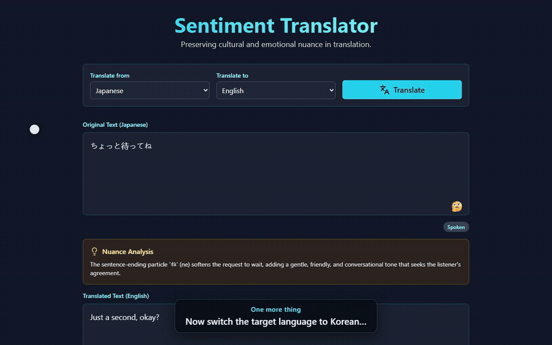
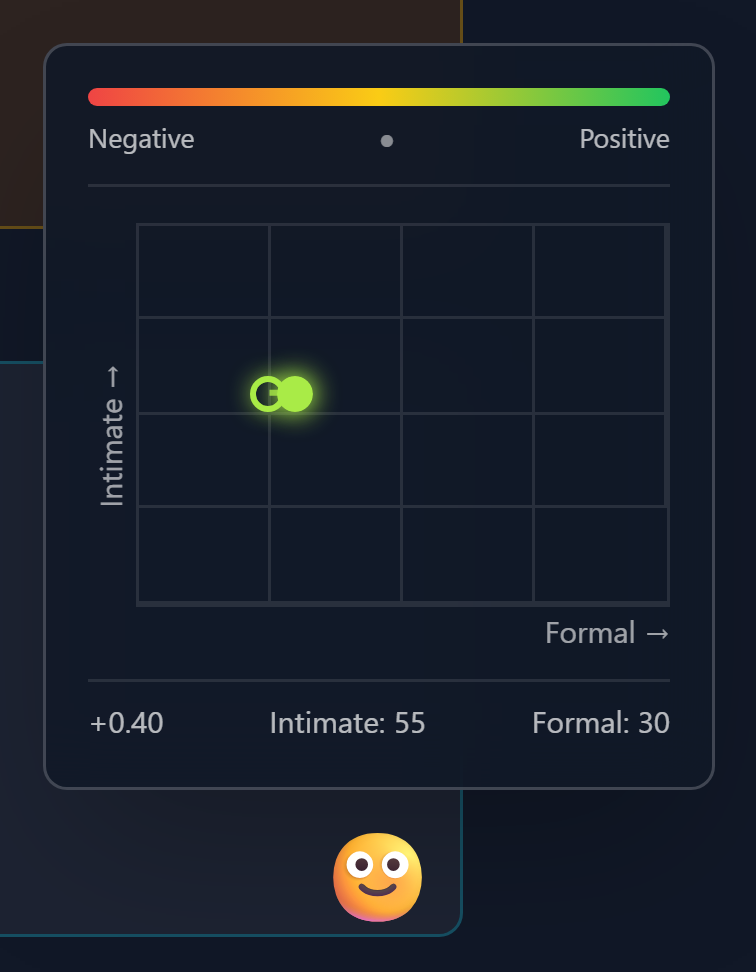

# Sentiment Translator 
Vibe coded a prototype based on my previous papers on the topic of sentiments and emojis.

- Paper 1: Modalpartikeln': Can Sentiments Survive Translation with Emojis? (https://github.com/bakeyeon/Modalparticles_Emojis)
- Paper 2: How Much Sentiment Can Be Carried by Modal Particles? (https://github.com/bakeyeon/modalparticles_sentiment_analysis)
- Video Overview of 2 Papers: https://youtu.be/dYcz4MZNst4
- Medium Post: Can We Translate Our Sentiments? (https://medium.com/gopenai/can-we-translate-our-sentiments-140c55822ead?sharedUserId=kaiwritesornot)

## Demo

▶️ Click the GIF or [watch the full demo on YouTube (2:20)](https://youtu.be/on5TFSEBs4Q) to see it bigger: Thai *นะ*, German *doch mal* and Japanese *ね* translated into English, then the same analysis in Korean.

> **Note:** This is a concept video. The prototype's map is an early form of what I later developed into the SFF (Sentiment-Formality-Friendliness) framework: it plots positive–negative sentiment, intimacy and formality. To read more about SFF, see my latest paper, [The Grue Divide: When Cognitive Accuracy Doesn't Predict Affective Alignment](https://aclanthology.org/2026.pandora-1.2/) (PANDORA @ EMNLP 2026).

## Reading the sentiment map

Click the emoji in the corner of either text box to open its map.

- **Colour:** the closer to green, the more positive the sentence; red is negative, yellow is neutral. The bar at the top runs from −1 to +1.
- **Up:** the more intimate (close, friendly) the tone, the higher the dot.
- **Right:** the more formal or polite the tone, the further right the dot.
- **Two points:** on the translation's map, the hollow ring is the original and the filled dot is the translation. The dashed line between them shows how far the feeling moved in translation.
- **Numbers:** the footer gives the exact scores: sentiment (−1 to +1), intimacy (0–100) and formality (0–100).
- **Emoji:** the emoji is the one whose sentiment score is closest to the sentence's score, using scores from the [Emoji Sentiment Ranking](https://kt.ijs.si/data/Emoji_sentiment_ranking/).

In the example, *Komm doch mal vorbei!* is translated into English. Both versions stay warm, fairly intimate and casual, so the two points nearly overlap, and the score of +0.40 is matched to 🙂.

 

## Limitations
- Subjectivity of Survey Data: As the study relies on surveys of proficient language users, the data is inherently subject to individual interpretation and personal perception of emotional nuances.
- Small Sample Size and Robustness: With $N=35$ for Survey 1 and $N=112$ for Survey 2, the relatively small sample sizes may limit the statistical robustness and the generalizability of the findings to a broader population.
- Cross-Cultural and Linguistic Variables: Emotional perception is deeply tied to cultural background and language proficiency. These factors influence how both modal particles and emojis are interpreted, potentially limiting the universal applicability of the results.
- Contextual Ambiguity and Polysemy: Certain particles, such as ja or schon, can convey opposing sentiments (e.g., friendliness vs. annoyance) depending on the context. Assigning a fixed sentiment score to these particles involves a degree of arbitrary simplification of their pragmatic complexity.
- Syntactic Position and Pragmatic Variance: While it is standard linguistic practice to account for subtle shifts in meaning based on the exact position of an element within a sentence, this study did not strictly control for syntactic variables. Consequently, the findings may have inherent limitations in capturing the full range of pragmatic nuances associated with word order variations.
- Sample Size and Data Scaling: The study is limited by a relatively small sample size (N ≈ 100). Additionally, human sentiment scores were manually scaled to facilitate a clearer comparison with the models' output ranges. While this adjustment might affect the absolute numerical precision, the primary focus of this research was to observe the relative trends and emotional trajectories. Since the relative rankings and directions of sentiment shifts remain consistent, the comparative analysis between human intuition and AI models remains valid and insightful.

## Key Functions
- 📊 Nuance Analysis: It analyzes the emotional tone of both the original and translated text.
- 🙂 At-a-glance Emojis: It assigns an emoji to each text, giving you an instant feel for the underlying sentiment.
- 🗺️ Clickable Emotion Map: Click the emoji to see it expand, showing its position on a visual gradient map to gauge the emotional tone.

## Acknowledgments
I would like to thank Prof. Jacopo Romoli and Dr. Yulia Zinova for providing the insightful lectures and the academic environment that inspired this research. Their courses were instrumental in shaping the foundational ideas.
This project is vibe-coded with Google AI Studio. Special thanks to the Google Developers Program for providing the API credits and the Gemini Pro access that supported the initial implementation of this demo.

## Run Locally
**Prerequisites:**  Node.js

1. Install dependencies:
   `npm install`
2. Set the `GEMINI_API_KEY` in [.env.local](.env.local) to your Gemini API key
3. Run the app:
   `npm run dev`

