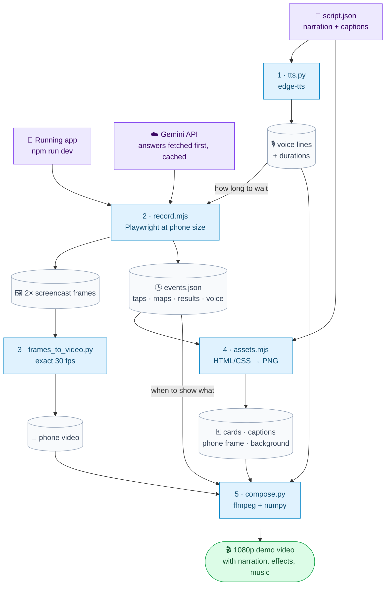

# How the demo video was made

The [narrated demo video](https://youtu.be/pZkeuCs8pf8) was made entirely with **[Claude Code](https://claude.com/claude-code)**, without a designer or video-editing software. Claude Code wrote and ran the scripts in [`demo/mobile/`](../demo/mobile/). It recorded the app on a simulated phone, designed the feature cards, generated the narration and sound, and composed the final video.

If you have a research prototype, you can introduce it the same way: a clear, narrated walkthrough that shows what the prototype does and why it matters. All the tools below are free and open source.

## The stack

| Job | Tool | What it does here |
|---|---|---|
| Drive and record the app | [Playwright](https://playwright.dev/) (Node.js) | Opens the app at phone size (390×844, touch) and taps, types and scrolls from a script |
| Sharp screen capture | Chrome DevTools Protocol screencast | Captures frames at 2× pixel density (Playwright's built-in video is low resolution) |
| Narration | [edge-tts](https://github.com/rany2/edge-tts) (Python) | Reads the script aloud with a natural neural voice (Ava) |
| Cards, captions, phone frame | HTML/CSS rendered to PNG | Designed like a web page, matching the app's glass style, and captured as transparent images |
| Composition | [ffmpeg](https://ffmpeg.org/) | Layers the background, phone video, cards, captions and a live zoom of the open map, with fades |
| Sound effects and music | Python (numpy, scipy) | Synthesises tap, whoosh and ding sounds and a soft music bed, and lowers the music under the voice |

## The pipeline



Purple boxes are inputs, blue boxes are the five scripts, grey shapes are what each step produces, and green is the finished video. `events.json` is the hub: everything after the recording is timed from it.

```bash
python demo/mobile/tts.py              # 1. narration from script.json -> voice/*.wav + durations
node   demo/mobile/record.mjs          # 2. drive the app at phone size, capture frames, log every event
python demo/mobile/frames_to_video.py  # 3. frames -> phone video at an exact 30 fps
node   demo/mobile/assets.mjs          # 4. render cards, captions, background and phone frame as PNGs
python demo/mobile/compose.py          # 5. compose the 1080p video and mix the audio
```

The app has to be running (`npm run dev`) for step 2.

| File | Role |
|---|---|
| [`script.json`](../demo/mobile/script.json) | What the voice says, and the caption text for each line |
| [`tts.py`](../demo/mobile/tts.py) | Generates the narration and measures how long each line takes |
| [`record.mjs`](../demo/mobile/record.mjs) | The scene script: taps, typing and scrolling, plus a log of when each card, voice line, map and result happens |
| [`frames_to_video.py`](../demo/mobile/frames_to_video.py) | Turns screencast frames into a phone video with exact timing |
| [`assets.mjs`](../demo/mobile/assets.mjs) | Card designs and the stage layout, plus the timeline |
| [`compose.py`](../demo/mobile/compose.py) | ffmpeg composition and audio mix |

## Three ideas that make it work

1. **One event log drives everything.** The recorder logs when each tap, map opening, translation result and voice line happens. Cards, captions, sound effects and the map zoom are all placed from that log, so nothing is synced by hand.
2. **Write the narration first.** Once the length of each voice line is known, the recorder waits for a line to finish before the next action. The voice and the screen then stay in step.
3. **Fetch API answers before recording.** LLM APIs can be slow or briefly unavailable (503). The recorder fetches the real answers first, retrying until they succeed, and serves them to the app during the take. The results are genuine, and every re-take looks the same.

## Tips

- **Small text:** a recorded desktop screen is hard to read in a small player. Recording at phone size and adding enlarged cards fixes this.
- **Sharp frames:** Playwright's `recordVideo` ignores the device pixel ratio. Launch Chromium with `--force-device-scale-factor=2` and use the DevTools screencast instead.
- **Exact timing:** ffmpeg's concat demuxer adds a little time to every image, so a video built from many frames drifts. Feed the frames through a pipe at a fixed frame rate instead.
- **ffmpeg 7+:** `-filter_complex_script` has been replaced by `-/filter_complex <file>`.
- **Narration licence:** edge-tts uses the voice behind Microsoft Edge's read-aloud feature through an unofficial route. It is fine for a research demo; for commercial use, prefer an official service such as Azure AI Speech.

## Adapting it to your prototype

1. Rewrite `script.json` with your own narration.
2. Change the scene script in `record.mjs`: what to tap and type, and which cards to show when.
3. Change the card designs in `assets.mjs`.
4. Run the five steps above.

Or describe the video you want to Claude Code, and let it adapt the scripts for you, as was done here.
